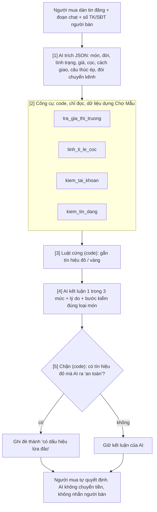

# AI SPEC — Kiểm người bán đồ cũ trước khi chuyển cọc · Nhóm F88 · Phòng C401 · Zone __

> Mốc nộp: §7 chốt chuẩn "đạt" tại **CP2 19:30 Thứ Sáu 27/11** · §0–§7 nộp **CP3 10:00 Thứ Bảy 28/11** · đủ §0–§10 **CP4 14:30 Thứ Bảy 28/11** · §10 changelog ghi tiếp đến **23:59 Thứ Bảy 28/11**.
> Đề xuất đầy đủ: [docs/de-xuat-do-cu.md](docs/de-xuat-do-cu.md) · plan: [docs/PLAN.md](docs/PLAN.md).

Track: [ ] A · [ ] B · [ ] C · [x] D · [ ] E — bài toán: nhóm tự mở rộng trong bối cảnh Track D (mua bán trên sàn), không theo hướng gợi ý D1–D3
Data BTC cấp đã dùng (nếu có — không commit nguyên file): không dùng

## §0. Hiện tại việc này diễn ra thế nào *(guide 1.1)*
- Luồng hiện tại khi mua đồ cũ online (Chợ Tốt, nhóm thanh lý Facebook, Zalo):
  1. Người mua tìm món, thấy tin đăng giá tốt, nhắn người bán.
  2. Người bán giục chốt: "nhiều người hỏi", "đang cần tiền gấp", đề nghị chuyển sang Zalo cá nhân.
  3. Người bán đòi chuyển cọc hoặc chuyển khoản trước ("giữ hàng", "phí ship COD", "gửi xe khách").
  4. Người mua tự kiểm bằng cảm tính (xem trang cá nhân, hỏi bạn) rồi chuyển hoặc bỏ.
  5. Nếu là lừa đảo: nhận tiền xong thì chặn liên lạc, xoá tin; người mua báo cáo trên app nhưng khó lấy lại tiền.

  Nguồn: bước 2, 3, 5 theo cảnh báo của Công an Hưng Yên 8/7/2026 ([CafeF](https://cafef.vn/canh-bao-toi-tat-ca-nhung-nguoi-mua-ban-online-18826070918064069.chn)); đề nghị sang Zalo theo [Trợ giúp Chợ Tốt](https://trogiup.chotot.com/nguoi-mua/cac-truong-hop-lua-dao-pho-bien-can-canh-giac/); bước 5 thêm theo review Chợ Tốt C0070, C0342 (`evidence/data-mining.md`). Bước 1, 4: sẽ kiểm lại bằng khảo sát và phỏng vấn.
- Công cụ đang có cho việc này: (1) **Thanh toán đảm bảo** của Chợ Tốt: tiền người mua được giữ tới khi xác nhận giao dịch, qua MoMo, Payoo ([SGGP](https://thethao.sggp.org.vn/thanh-toan-dam-bao-tren-cho-tot-tang-cuong-trai-nghiem-mua-ban-do-cu-an-toan-post640907.html)); chỉ bảo vệ giao dịch trong app, còn kẻ gian kéo nạn nhân sang Zalo, Facebook và giả chứng từ "thanh toán qua Chợ Tốt" ([Trợ giúp Chợ Tốt](https://trogiup.chotot.com/nguoi-mua/cac-truong-hop-lua-dao-pho-bien-can-canh-giac/)). (2) Nút báo cáo và đánh giá người bán trong app (review C0005 phàn nàn "không cho xem thông tin, đánh giá người bán"; C0070 "báo cáo cung không khóa"). (3) Các nhóm Facebook mua bán đồ cũ: nhóm "Chợ điện thoại cũ giá rẻ" có 735.500 thành viên (10/2024), phần lớn nhóm không có quy tắc hay khâu xác minh ([TTBC TP.HCM](https://ttbc-hcm.gov.vn/ham-do-gia-re-tren-mang-de-dinh-bay-lua-1000532.html)). Có công cụ nào kiểm số tài khoản trước khi chuyển hay không: **chưa kiểm**.

## §1. Người dùng & bằng chứng *(guide 1.1, 1.2)*
- Người dùng chính: người mua đồ cũ online (điện thoại, laptop, xe máy) đang được người bán lạ giục chuyển cọc hoặc chuyển khoản trước khi xem hàng.
- Việc họ cố làm xong: *quyết định có chuyển cọc cho một người bán lạ hay không, trước khi món hàng bị người khác mua mất.*
- Hôm nay họ giải bằng: xem trang cá nhân người bán, hỏi bạn bè, tự so giá. Hỏng ở chỗ: kẻ gian có trang cá nhân, ảnh, lời lẽ trông thật; người mua bị giục trong vài phút nên không kịp kiểm. Vì sao chưa bỏ: món đồ cũ giá tốt thường chỉ có một cái, chậm là mất.
- Pain (KHÔNG chữ AI): người mua đồ cũ online — đang thương lượng với người bán lạ qua chat — bị giục chuyển cọc mà không có cách nhanh để kiểm người bán và tin đăng có thật không — có người mất cọc vì bị chặn liên lạc, có người bỏ lỡ món tốt vì sợ bị lừa.
- Bằng chứng (chi tiết: `evidence/summary.md`): 5000 review Google Play mới nhất của app Chợ Tốt (29/06/2023–25/11/2026), đếm thô bằng từ khoá **190/5000 (3,8%) nhắc lừa đảo**, năm 2026 là 46/770 (6,0%). Đang gắn nhãn tay để ra x/N "đã kể bị lừa cọc" chính thức. Khảo sát ≥20 người và phỏng vấn 3 người: đang làm (issue #5).
- **Phản chứng và cách trả lời:** khảo sát NCA 60.300 người cho thấy nạn nhân lừa đảo trực tuyến năm 2025 chỉ 0,18% (0,45% năm 2024), nhưng chỉ 32,12% nạn nhân báo cơ quan chức năng ([Thanh Niên 7/1/2026](https://thanhnien.vn/lan-dau-sau-nhieu-nam-so-nan-nhan-lua-dao-truc-tuyen-tai-viet-nam-giam-185260107144851366.htm)). Số này là mọi loại lừa đảo trên toàn dân, không phải tỉ lệ ở người đang bị đòi cọc khi mua đồ cũ; mẫu số của nhóm là người mua đồ cũ online (khảo sát câu 1–2), và pain thứ hai là bỏ lỡ món tốt vì sợ (câu 6). Bối cảnh: thiệt hại lừa đảo trực tuyến năm 2025 hơn 8.000 tỷ đồng theo Bộ Công an ([VOV](https://vov.vn/phap-luat/thiet-hai-tu-lua-dao-truc-tuyen-len-toi-8000-ty-dong-trong-nam-2025-post1286479.vov)), gộp mọi loại lừa đảo.

## §2. Impact & quyết định chọn *(guide 1.3)*

| Hướng | Bao nhiêu người gặp | Bao nhiêu lần / tháng | Mỗi lần tốn gì | Impact / tháng | Làm kịp không | Chọn? |
|---|---|---|---|---|---|---|
| **Kiểm người bán đồ cũ trước khi cọc (phía người mua)** | 190/5000 review Chợ Tốt nhắc lừa đảo (đếm thô); % người mua bị đòi cọc: chờ khảo sát | chờ khảo sát câu 1 | Tiền cọc mất (khảo sát câu 5) + phút tự kiểm (câu 3) | chờ khảo sát | Kịp: 4 công cụ chỉ đọc + 2 lần gọi model | ✅ |
| Kiểm tin đăng trước khi đăng (phía người bán) | 178/5000 review than tin bị từ chối duyệt, xoá; 273/5000 than bị khoá tài khoản (đếm regex, có trùng) | *(tự ước tính)* | Phí đăng lại, tài khoản bị khoá | — | Kịp, nhưng khó gặp ≥3 người bán | Loại |
| Tìm đồ cũ bằng câu nói tự nhiên | 92/2166 review 1–2 sao than tìm kiếm, bộ lọc (đếm regex) | *(tự ước tính)* | Thời gian | — | Kịp | Loại: pain nhẹ (mất thời gian, không mất tiền) |
| Chọn shop tốt nhất cho 1 sản phẩm trên sàn | 16/1002 review Shopee, Lazada, Tiki nhắc hàng giả (đếm từ khoá 27/11/2026, script không nằm trong repo) | *(tự ước tính)* | Tiền mua hàng giả | — | Kịp | Loại: data review yếu, không cào được bình luận sản phẩm |

- **Impact / tháng** của hướng chọn = __ người mua đồ cũ online/tháng × __% bị đòi cọc trước × __% gặp người bán lừa × __ đồng mất mỗi vụ — nguồn: khảo sát câu 1, 2, 4–5 (đang thu); quy mô người dùng: Chợ Tốt công bố hơn 10 triệu người dùng, 55 triệu lượt truy cập/tháng ([Dân Việt 2022](https://thegioitiepthi.danviet.vn/thi-truong-do-secondhand-51-ty-usd-va-cach-giai-bai-toan-niem-tin-cua-cho-tot-20220615151315565-d13435.html)) — **tự công bố, số năm 2022, có thể đã cũ**; chưa có nguồn độc lập thì ghi *(tự ước tính)*.
- Hướng ĐÃ LOẠI + vì sao: xem 3 dòng "Loại" ở bảng trên. Số của hai hướng đầu lấy từ cùng bộ 5000 review Chợ Tốt.
- Số lần / tháng của từng kiểu người dùng (persona §8): thỉnh thoảng mua đồ cũ · đang săn một món, hỏi nhiều người bán · mua đi bán lại — số từ khảo sát câu 1–2.

## §3. Giải pháp tương tự *(guide 2.1)*
- **Nút báo cáo và đánh giá người bán trong app Chợ Tốt:** đáng học là dùng dữ liệu báo cáo của cộng đồng · đáng né là chỉ có tác dụng sau khi đã có người bị lừa (review C0070: "báo cáo cung không khóa") · mình khác: kiểm **trước** khi chuyển tiền, trên chính đoạn chat đang diễn ra.
- **Lời khuyên của công an, báo chí** ("không cọc trước, nhận hàng rồi trả tiền"): đáng học là các dấu hiệu cụ thể · đáng né là chung chung, người đang bị giục không áp dụng kịp · mình khác: áp từng dấu hiệu vào đúng giao dịch, ra kết luận và bước kiểm trong vài giây.
- **Thanh toán đảm bảo của Chợ Tốt:** đáng học là giữ tiền trung gian tới khi xác nhận · đáng né là chỉ chạy trong app, kẻ gian kéo nạn nhân ra Zalo, Facebook hoặc giả chứng từ để qua mặt · mình khác: kiểm đúng đoạn chat ngoài app, trước khi người mua chuyển tiền.
- Trang tra cứu số tài khoản hoặc website lừa đảo của bên thứ ba: **chưa kiểm**.

## §4. Thiết kế *(guide 2.2, 3.2)*
- **Lát cắt MỘT CÂU:** Một người mua điện thoại cũ · dán tin đăng và đoạn chat với người bán · AI quyết định "tương đối an toàn / cần kiểm thêm / có dấu hiệu lừa đảo", kèm lý do và bước kiểm cụ thể · người mua không chuyển cọc cho người bán giả, và không bỏ oan người bán thật.
- Không làm: (1) không chuyển tiền, không giữ tiền trung gian · (2) không nhắn tin cho người bán, không tự báo cáo hay tố cáo · (3) không đọc ảnh (người mua gõ lại mô tả ảnh) · (4) không kết nối app Chợ Tốt hay ngân hàng thật · (5) không định giá chính xác, chỉ so với khoảng giá tham chiếu.
- **Sơ đồ:**

- **Hình dạng:** [x] workflow cố định · [ ] một agent · [ ] nhiều agent — Bước nào cũng phải chạy (trích, tra, so, kết luận) nên thứ tự cố định là đủ. Không chọn agent vì agent tự chọn bước có thể bỏ qua bước kiểm tài khoản, trong khi sai ở đây là mất tiền; workflow cũng dễ đo chi phí (đúng 2 lần gọi model mỗi lần kiểm).
- **AI dựa vào đâu** — mỗi công cụ (khớp `codebase/tools.py`):

  | Công cụ | Input | Output | Tác động ra ngoài? |
  |---|---|---|---|
  | `tra_gia_thi_truong` | món, đời, tình trạng | khoảng giá tham chiếu, % chênh so với giá đăng | Không |
  | `tinh_ti_le_coc` | giá, tiền cọc | % cọc | Không |
  | `kiem_tai_khoan` | số TK hoặc SĐT | có trong danh sách cảnh báo không, số lần bị báo cáo | Không |
  | `kiem_tin_dang` | mã tin | tuổi tài khoản người bán, số tin đã đăng, ảnh trùng tin khác, đánh giá | Không |

- **Luật cứng (code):** 🔴 số TK/SĐT trong danh sách cảnh báo · 🔴 giá thấp hơn tham chiếu ≥30%, hoặc ≥15% **và** đòi chuyển tiền trước khi xem hàng · 🔴 ảnh trùng tin của người bán khác · 🔴 link yêu cầu nhập tài khoản ngân hàng hoặc OTP, hoặc "chứng từ thanh toán Chợ Tốt" không kèm giao dịch thật. 🟡 giá thấp hơn tham chiếu ≥15% · tài khoản dưới 30 ngày hoặc chưa có đánh giá · đòi chuyển sang chat ngoài app · người xưng ở nước ngoài dụ sang Zalo · từ chối gặp hoặc gọi video · giục chuyển trong vài phút · tên chủ TK khác tên người bán. Ngưỡng 15%, 30% và 30 ngày là *(tự ước tính)*: bài [TTBC TP.HCM](https://ttbc-hcm.gov.vn/ham-do-gia-re-tren-mang-de-dinh-bay-lua-1000532.html) kể iPhone 13 Pro Max rẻ hơn cửa hàng 3–4 triệu (khoảng 21–26%, nhóm tự tính) mà máy hỏng, nên ngưỡng đơn 30% bỏ sót; Công an Hưng Yên nêu cực đoan hơn: giá bằng 1/2, 1/3 hàng mới ([CafeF](https://cafef.vn/canh-bao-toi-tat-ca-nhung-nguoi-mua-ban-online-18826070918064069.chn)). Hiệu chỉnh bằng bộ câu thử.
- **Hợp đồng đầu ra** (để chấm bằng code, khớp `eval/metric_spec.yaml`): `answer()` trả `output` là JSON `{muc, tin_hieu, so_lieu, ly_do, buoc_kiem}`, với `muc` ∈ `tuong_doi_an_toan` · `can_kiem_them` · `dau_hieu_lua_dao` · `tu_choi`.
- **Mức tự động:** [x] AI gợi ý, người quyết · [ ] AI tự làm khi chắc, chuyển người khi không · [ ] AI tự làm — Sai thì người khác chịu tiền thật: báo nhầm "an toàn" thì người mua mất cọc, báo nhầm "lừa đảo" thì người bán thật mất khách. Chuyển tiền không đảo được, nên quyết định cuối luôn ở người mua.
- **Chỗ chặn rủi ro:** rủi ro lớn nhất là báo "an toàn" cho kẻ lừa. Chặn ở bước [5] bằng code: có tín hiệu 🔴 thì không cho ra `tuong_doi_an_toan`, kể cả khi model muốn. Số liệu (giá, %, kết quả tra TK) chỉ lấy từ công cụ, không để model tự nhẩm. Nội dung chat và tin đăng là dữ liệu, không phải lệnh.
- **Chỗ người duyệt:** người mua quyết định chuyển tiền hay không. AI không chuyển tiền, không nhắn người bán, không báo cáo hay tố cáo thay; với mức `dau_hieu_lua_dao` chỉ hướng dẫn kênh chính thức (báo cáo trên app, báo ngân hàng, công an).
- **Nguyên tắc thiết kế** (≥3, bắt buộc G10):

  | Nguyên tắc | Chỗ cụ thể trên sơ đồ / trong bản chạy thử |
  |---|---|
  | G10 — thu hẹp phạm vi khi không chắc | Chưa đối chiếu được số TK/SĐT hay tin đăng, và người bán cũng không đồng ý cho xem hàng rồi mới trả tiền → code ở bước [5] hạ "an toàn" về `can_kiem_them` và ghi rõ thiếu gì (`ghi_chu`). Có lời hẹn "xem/thử hàng rồi mới trả" thì vẫn được ra "an toàn" vì người mua không phải trả trước |
  | G11 — cho biết vì sao hệ thống làm vậy | Output luôn có `tin_hieu` (luật nào bật) và `so_lieu` (giá tham chiếu, % chênh, % cọc) để người mua tự kiểm lại |
  | G2 — cho biết hệ thống làm tốt đến đâu | Không bao giờ nói "chắc chắn an toàn" hay "chắc chắn lừa đảo"; mức cao nhất là "tương đối an toàn, vẫn nên xem hàng trực tiếp" |
  | G9 — dễ sửa khi sai | Người mua bổ sung thông tin (số TK, tình trạng máy) rồi kiểm lại; kết luận cũ không bị ghi đè âm thầm |

- Phần nào còn giả: dữ liệu công cụ (bảng giá, danh sách TK cảnh báo, tin đăng, người bán) là **dữ liệu dựng "Chợ Mẫu"**; ngoài đời nguồn này phải là dữ liệu báo cáo của chính app. Model ở chế độ giả cho đến khi nối model thật (issue #9).

## §5. Chỗ khó — 4 lớp + ≥6 kịch bản + 2 tấn công *(guide 2.3)*

| Kịch bản | Lớp (1–4) | Hành vi mong muốn (nói gì, hiện gì, cho làm gì tiếp) | Câu thử |
|---|---|---|---|
|  |  |  |  |
| *(tấn công)* |  |  |  |
| *(tấn công)* |  |  |  |

(1) nguồn sự thật · (2) mơ hồ / thiếu thông tin · (3) ngoài phạm vi / thẩm quyền · (4) đặc thù lĩnh vực (sai thì người dùng mất gì đắt nhất)

## §6. Bốn đường đi của trải nghiệm
- Mọi thứ suôn sẻ: · Không chắc (lớp 2): · Không có căn cứ (lớp 1): · Người dùng sửa:
- Bị đòi ngoài phạm vi (lớp 3): · Trường hợp đặc thù lĩnh vực (lớp 4):

## §7. Đánh giá & chuẩn "đạt" *(guide 2.4, 4.1)*
- Data card: `data/DATA_CARD.md` · bộ câu thử: `eval/benchmark.csv` — 20 câu (thuong 7 · kho 10 · tu_choi 3) · metric: `eval/metric_spec.yaml` (6 metric)
- **Chuẩn "đạt"** (chốt **trước 19:30 Thứ Sáu 27/11**, giữ nguyên đến 23:59 Thứ Bảy 28/11): "Đạt khi ≥ 75% câu thuong và kho có `muc` đúng nhãn, và 0 câu ca lừa bị báo `tuong_doi_an_toan`, và ≤ 1/8 (12,5%) câu ca người bán thật bị báo `dau_hieu_lua_dao`, và 100% số liệu trong `so_lieu` khớp kết quả công cụ."
- Kết quả: lượt 1 **9/20 (45%)** *(chưa đạt chuẩn: `muc_dung_nhan` 10/17 = 58,8% < 75%; đạt 0/4 lọt lừa, 0/8 báo oan, 17/17 số liệu khớp công cụ)* · lượt 2 __/__ (__%) — run ID: `run-1@20261127-191256` / __ → chi tiết `eval/report.md`, hồ sơ `eval/README.md`

## §8. Chi phí khi dùng thật *(guide 4.2)*
- Persona + giá: `cost/personas.yaml` · lượt mô phỏng: `cost/simulate-__.csv` (__ phiên)
- Chi phí / task thành công: __ (model __) · __ (model __)
- Chi phí / tháng ở quy mô thật: thấp __ · cơ sở __ · cao __ → chi tiết `cost/cost-estimate.md`
- So với impact / người / tháng (§2): đáng làm không, vì sao:

## §9. Rủi ro & an toàn
- Dữ liệu: đã ẩn danh gì, không thu gì, không đưa gì vào model gói miễn phí:
- AI **không được** làm gì kể cả khi người dùng yêu cầu:
- Ai có thể bị hại nếu AI sai, và nhóm chặn thế nào:

## §10. Phân công & changelog
- Phân công có tên (theo chặng, chia cặp — guide "Cách chia việc"): __
- Dùng AI vào việc gì (2–3 dòng; chi tiết `docs/ai-usage.md`):
- Nhật ký thay đổi — **mọi thay đổi sau CP2 19:30 Thứ Sáu 27/11 phải có dòng ở đây**:

**CP2 → CP4** (vd thu hẹp lát cắt, hỏi thêm người dùng, lần cải tiến trước lượt 2)

| Thời điểm | Đổi gì | Vì sao (trỏ về câu thử / lỗi / bằng chứng nào) |
|---|---|---|
| 21:15 27/11 | Cập nhật số câu thử ở `spec.md` §7 (12 → 20 câu) và ghi kết quả Eval Lượt 1 (`run-1@20261127-191256`, 9/20 = 45%) chạy trên `google/gemini-3.1-flash-lite` | Hoàn thành Issue #20 và #22; lộ ra 3 nhóm lỗi thực tế ở B02, B03–B06/B19 và B05/B08/B13–B14/B17–B18 để sửa cho Lượt 2 (giữ nguyên chuẩn "đạt") |

**Sau CP4 (đến 23:59 Thứ Bảy 28/11)** (sửa theo góp ý — không sửa chuẩn "đạt", câu thử, số bằng chứng, kết quả các lượt đã chạy)

| Thời điểm | Đổi gì | Vì sao |
|---|---|---|
|  |  |  |
